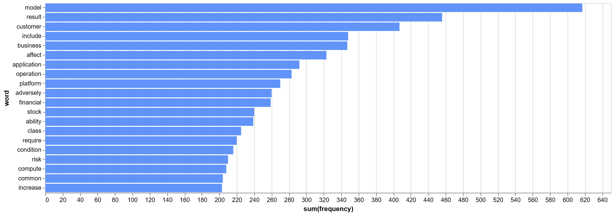
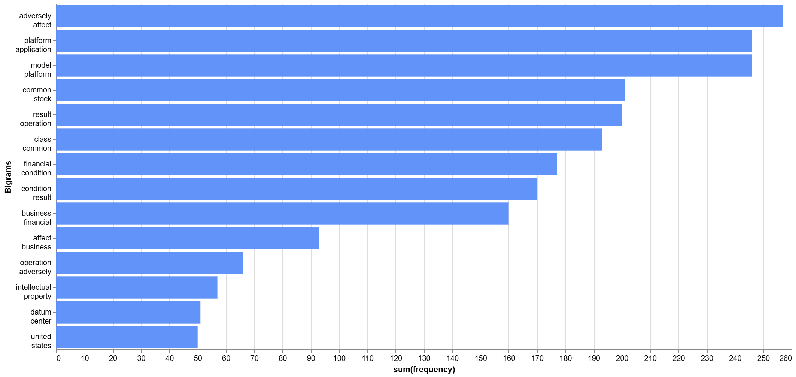
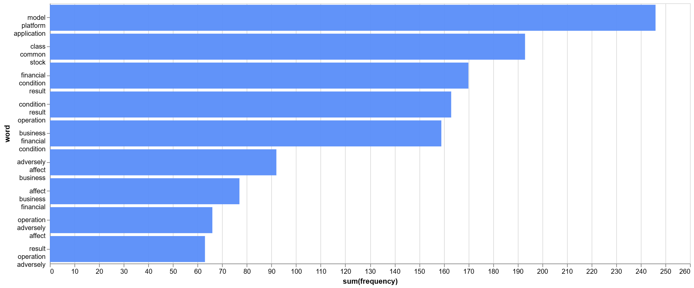
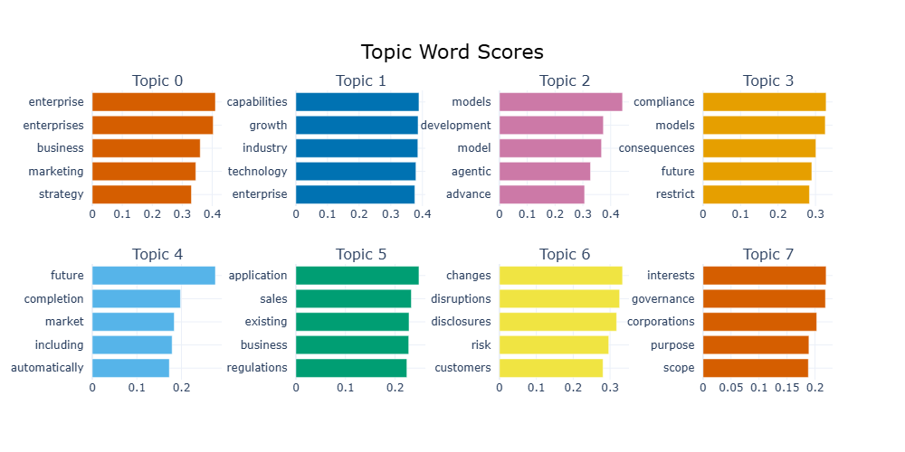

Anthropic recently filed for an [Initial Public Offering (IPO)](https://www.anthropic.com/news/s1-sec) and some buyers are discussing a valuation of over \$1.1 trillion. Trillion Dollars.


I was reading through it's [S-1 filling](https://www.sec.gov/Archives/edgar/data/2130357/000162828026067168/anthropicpbc-sx1.htm) on EDGAR and as I was skimming through the document, I came across the 'Risk Factors' section. This section includes information about significant risks that the company faces, generally listed in order of importance. I knew that 'Risk Factors' is present in [Annual 10-K reports](https://www.investor.gov/introduction-investing/getting-started/researching-investments/how-read-10-k), but to see one in a S-1 filing was news to me. But more importantly, I was curious to see how Anthropic describes the risks it faces.

If you go to page 27 of the S-1 filing, you are greeted by a huge disclaimer that reads as follows:

> The disclosures in this section reflect our beliefs and opinions as to matters that could materially and adversely affect us in the future, and are not representations as to whether such matters have or have not occurred previously, except as otherwise disclosed. References to past events are provided by way of example only and are not intended to be a complete listing or a representation as to their likelihood of occurring in the future. Our business, financial condition, results of operations, or prospects could also be adversely affected by risks and uncertainties not currently known to us or that we currently do not believe are material. If any of the risks actually occur, our business, financial condition, results of operations, and prospects could be adversely affected. In that event, the market price of our Class A common stock could decline, and you could lose part or all of your investment.

Now I know the 'Risk Factors' section is not indicative of the actual risks that Anthropic faces. But nevertheless, I was curious to do a very basic Natural Language Processing (NLP) analysis of this section to see if I could identify any key insights, trends or anything that might be of value. Plus I thought it would be a good excuse to try out [Edgartools](https://edgartools.readthedocs.io/en/latest/), an open source Python package that I recently came across and is used for accessing, analysing and extracting insights from SEC filings.

First step was accessing the S-1 filing. This [documentation page](https://edgartools.readthedocs.io/en/latest/guides/registration-s1-data-object-guide/?h=1+s) was really helpful.

```{python}
## Testing Python

from edgar import *
set_identity("joey23@example.com")

filing = find("0001628280-26-067168")   
s1 = filing.obj()                       
s1

```

Turns out you can fetch all the filings for a given ticker using the official ticker symbol or the SEC Accession No. I tried using 'ANT' (Anthropic's official ticker symbol) but for some reason it gave me an error message. Therefore I settled for the SEC Accession No**.** 0001628280-26-067168

Then I was interested in extracting just the 'Risk Factors' section.

```{python}
risk_factors_text = s1.sections.get("risk_factors").text()

```

Nice! Pretty amazing what a few lines of code can do these days.

But before I could start doing fun stuff, I had to preprocess the data: remove stop words, tokenize, convert to lowercase, remove special characters etc. I leveraged the script from [this tutorial](https://www.tilburgsciencehub.com/topics/manage-manipulate/manipulate-clean/textual/text-prep-python/) by Tilburg University.

```{python}
import spacy
import re
from spellchecker import SpellChecker

# Load the spaCy model
nlp = spacy.load('en_core_web_sm')


# Define the text preprocessing function
def preprocess_text(text):
    # Convert to lowercase to normalize the case
    text = text.lower()

    # Remove URLs
    text = re.sub(r'https?://\S+|www\.\S+', '', text)

    # Remove special characters, keeping only words and basic punctuation
    text = re.sub(r'[^a-zA-Z0-9\s,.?!]', '', text)

    # Reduce excessive character repetition to a maximum of two occurrences
    text = re.sub(r'(.)\1{2,}', r'\1\1', text)

    # Tokenize and lemmatize the text, removing stop words, punctuation, and short words
    doc = nlp(text)
    tokens = [token.lemma_ for token in doc if not token.is_stop and not token.is_punct and len(token.text) > 2]

    # Correct tokens with repeated characters using a spell checker
    spell = SpellChecker()
    corrected_tokens = [spell.correction(token) if re.search(r'(.)\1', token) else token for token in tokens]

    # Join the tokens back into a single string, removing any potential None values
    return " ".join(token for token in corrected_tokens if token is not None and token != '')

# Apply the preprocessing function to the 'risk_factors_text'
cleaned_text = preprocess_text(risk_factors_text)

```

Now that the data has been preprocessed, I thought why not generate wordcloud and see if I can find something interesting.

```{python}
from nltk.tokenize import word_tokenize
from wordcloud import WordCloud, STOPWORDS
import matplotlib.pyplot as plt

words = word_tokenize(cleaned_text)


#wordcloud = WordCloud().generate(words)
#plt.imshow(wordcloud, interpolation='bilinear')
#plt.axis("off")
#plt.show()

from wordcloud import WordCloud, STOPWORDS
import matplotlib.pyplot as plt

wordcloud = WordCloud(
    width=1000,
    height=500,
    background_color="white",
    stopwords=STOPWORDS
).generate(cleaned_text)

plt.figure(figsize=(15, 7))
plt.imshow(wordcloud, interpolation="bilinear")
plt.axis("off")
plt.show()


```

How about something more intuitive? Maybe a bar chart showing the frequency of most commonly occuring words in Anthropic's 'Risk Factors' section? For this I decided to use [PygWalker](https://github.com/kanaries/pygwalker).

```{python}
import pandas as pd
from nltk import ngrams
from collections import Counter
import pygwalker as pyg

bow = Counter(words)
bow2 = Counter(ngrams(words,2))
bow3 = Counter(ngrams(words,3))

data = pd.DataFrame(bow.items(), columns= ['word','frequency']).sort_values(by= 'frequency', ascending=False)
data1 = pd.DataFrame(bow2.items(), columns= ['word','frequency']).sort_values(by= 'frequency', ascending=False)
data2 = pd.DataFrame(bow3.items(), columns= ['word','frequency']).sort_values(by= 'frequency', ascending=False)

```



Model was the most commonly word in the section with 617 instances. AI company has 'model' as the most commonly occurring word?!?! Color me shocked. Customer had 407 instances. It makes sense considering customers use Anthropic's LLMs.

But words by themselves don't tell us the complete picture. While I was at it, I thought why not do a bigram and trigram analysis as well to get more context?



'Adversely affect' had the highest frequency of 257, followed by 'platform application' and 'model platform' both tied at 246. As you can see there were a lot of S-1 specific stop word pairs such as 'common stock', 'class common' and 'business financial'. I am pretty sure removing these custom stopwords would eliminate a lot of noise from our dataset. I found 'operation adversely', 'intellectual property', 'datum center' (the word 'data' got lemmatized to 'datum') and 'united states' pretty interesting.

Given the current state of AI development, simply reading through these, I am sure we can all conceptualize what these bigrams are alluding to. Let's look at some of the closely:

- 'Operation adversely':

  - We face intense competition, and if we are unable to compete effectively, our business, financial condition, and results of operations could be adversely affected.

  - If the market for our models, platform, and applications develops more slowly than we expect or declines, our growth may slow or stall, and our business, financial condition, and results of operations could be adversely affected.

  - Our business is subject to an evolving and uncertain regulatory and political environment, which could increase our costs, restrict our operations, or adversely affect demand for our models, platform, and applications.

- 'intellectual property'

  - AI algorithms may be flawed, and AI systems may contain bugs, errors, or defects or fail to follow instructions or produce inaccurate, misleading, offensive, inappropriate, or otherwise harmful outputs; reflect or amplify unwanted or unknown biases present in training data; or raise concerns relating to intellectual property, privacy, or other legal and ethical considerations.

  - Our expansion into new geographic markets further compounds these risks, as we must navigate differing cultural norms regarding AI use, comply with diverse and evolving regulatory regimes that may impose varying safety, compliance, or liability requirements, address language-specific vulnerabilities and content moderation challenges, and potentially face regulatory enforcement actions, litigation, or other liabilities in jurisdictions where we have more limited operational experience, including heightened risks of intellectual property theft, unauthorized model access, or misuse associated with operating data center infrastructure in certain non-U.S. locations

- 'datum (data) center'

  - Chip manufacturers, CSPs, and data center developers require advance commitments in order to allocate production capacity, plan infrastructure investments, and manage their own supply chains.

  - An acceleration of our indebtedness, combined with the loss of access to critical data center infrastructure, among other things, could impair our ability to train and deploy models, serve customers, and fund ongoing operations, which could have an adverse effect on our business, financial condition, and results of operations.

  - The operation of data centers at the scale required for frontier AI development and deployment consumes substantial quantities of electrical power. The availability of sufficient electrical power has emerged as a significant constraint on data center development and expansion in many geographies, including the United States.

- 'united states'

  - Electrical grid infrastructure in the United States and other countries was not designed to accommodate the rapid increase in demand associated with AI development, and the lead times required to build new generation capacity, transmission infrastructure, and grid interconnections can extend for years.

  - Efforts to establish sufficient advanced chip manufacturing capacity outside of Taiwan, including in the United States, remain in early stages and may not produce adequate compute to materially reduce these concentration risks within the foreseeable future.

  - A meaningful portion of the components we and our partners rely on is sourced from or manufactured outside of the United States, and new or increased tariffs, import restrictions, or trade disputes could delay deliveries, force supply-chain changes, or raise our costs, some of which we bear directly under pass-through arrangements.



Finally, I wanted to see if there are any inherent topics present in the section. For this, I decided to use [BERTopic](https://maartengr.github.io/BERTopic/getting_started/quickstart/quickstart.html#quick-start).

I initially tried the base version but I decided to KeyBERTInspired, which increases the coherence and reduces stopwords from the resulting topic representations.

```{python}
import nltk  
from sentence_transformers import SentenceTransformer
from bertopic import BERTopic
from umap import UMAP


from bertopic import BERTopic
from bertopic.representation import KeyBERTInspired

sentences = nltk.sent_tokenize(risk_factors_text)  
representation_model = KeyBERTInspired()
topic_model = BERTopic(representation_model=representation_model)
topics, probs = topic_model.fit_transform(sentences)

```

```{python}
topic_model.get_topic_info()
```

See if any of these topics standout.

I was looking at some of the cool visualization available on BERTopic. I thought why not give it a go?

```{python}
fig = topic_model.visualize_topics()

fig.write_html(
    "topic_visualization.html",
    include_plotlyjs="cdn",
    full_html=True
)

```

```{=html}
<iframe
  src="topic_visualization.html"
  width="100%"
  height="700"
  style="border:none;">
</iframe>
```

```{python}
fig1 = topic_model.visualize_barchart()

fig1.write_html(
    "topic_visualization1.html",
    include_plotlyjs="cdn",
    full_html=True
)
```



All in all, I think the results were...okay?

NLP certainly has limitations and I could have probably refined some of the steps along the way. For instance, I could have removed some of the SEC specific stopwords. When it comes to topic modelling, I realized it wasn't much of a value add because the raw text has already been categorized in different topics such as 'Supply and Concentration of Chips, Memory, and Data Center Equipment' and 'Electrical Power and Fuel Constraints'. Now if this was an unsupervised learning task, wherein I had to find topics, then I think topic modelling would had been pretty useful. Finally, you might be wondering "why didn't I simply run this analysis via a LLM?"

My answer is:


Don't get me wrong. I did think long and hard about using a LLM to extract insights. But then I thought to myself "how would it be any different than simply uploading the filing and asking a LLM to summarize the key insights?" Also I do have gemma4:12b running locally on my PC. At the time, I just didn't see the utility in using a LLM to summarize key insights of a S-1 filing by a company that also provides one of the most popular LLMs. That being said, I do see an opportunity to use LLMs for enhancing topic modelling. Turns out BERTopic has a [functionality](https://maartengr.github.io/BERTopic/getting_started/representation/llm.html#llama-manual-quantization) to generate better labels for the topics.

So there it is, an extremely bare bones NLP analysis of Anthropic's Risk Factors listed in its S-1 filing. Maybe this analysis didn't result in the giving me detailed insights that I was expecting. But at the very least, I learned a thing or two but some new avenues I can explore for future projects!
